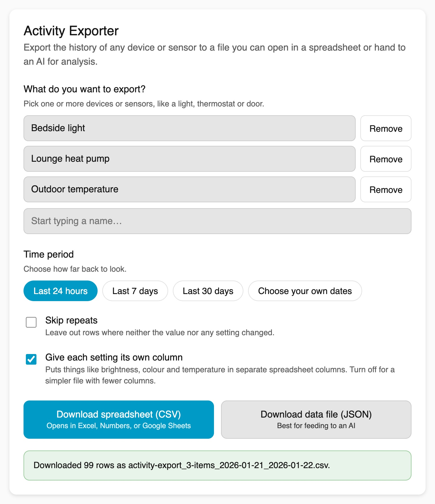

# Activity Exporter for Home Assistant

Export the history of one or more devices or sensors to a **CSV** or **JSON** file,
straight from a panel in your Home Assistant sidebar. No configuration, no scripting.

It's built for one job: getting a clean, faithful dump of your devices' history out of
Home Assistant so you can open it in a spreadsheet or hand it to an AI for analysis.

> **Designed for everyone.** You don't need to know any Home Assistant jargon to use
> it. Pick your devices, pick a time period, click download.



## What it does

- 🔎 **Pick a device or sensor** with a searchable selector, or add up to 20 to export them together in one file.
- 🗓️ **Choose a time period** — quick buttons (last 24 hours / 7 days / 30 days) or your own start and end dates.
- 🎚️ **Every setting in its own column** - brightness, colour, temperature, position and more each get a column in the spreadsheet, and every recorded step is included, so you can see exactly what a device did and when.
- 🧹 **Skip repeats** - an optional switch that leaves out rows where neither the value nor any setting changed, so your file isn't full of noise.
- 📊 **Download as a spreadsheet (CSV)** — opens in Excel, Numbers, or Google Sheets.
- 🤖 **Download as a data file (JSON)** — self-describing, ideal for feeding to an LLM.
- ⏳ **Live progress** while it gathers the history.

It does **not** change, summarise, or interpret your data. It exports the history
Home Assistant recorded (optionally minus the repeats).

## Installation

### Via HACS (recommended)

1. In Home Assistant, open **HACS → Integrations**.
2. Click the **⋮** menu (top-right) → **Custom repositories**.
3. Add `https://github.com/edwilde/ha-activity-exporter` with category **Integration**.
4. Find **Activity Exporter** in the list and click **Download**.
5. **Restart Home Assistant.**
6. Go to **Settings → Devices & Services → Add Integration**, search for
   **Activity Exporter**, and add it.
7. **Activity Exporter** now appears in your sidebar.

### Manual

1. Copy `custom_components/ha_activity_exporter/` into your Home Assistant
   `config/custom_components/` folder.
2. Restart Home Assistant and add the integration as in steps 5–7 above.

## Using it

1. Open **Activity Exporter** from the sidebar.
2. **What do you want to export?** Start typing the name of a device or sensor and pick it. To export several at once, add another; each chosen device is listed with a Remove button.
3. **Time period** — tap a quick button, or choose your own start and end dates.
4. Optionally turn on **Skip repeats** to leave out rows where nothing changed.
5. Leave **Give each setting its own column** on to get one spreadsheet column per setting (brightness, colour, temperature and so on), or turn it off for a simple three-column file (five columns when several devices are chosen).
6. Click **Download spreadsheet (CSV)** or **Download data file (JSON)**.

## What the files look like

**CSV** - one row each time Home Assistant recorded a change, including changes to a setting while the value stays the same. `seconds_since_previous` is the time since the row above it, and each setting has its own column. Descriptive information such as the name, icon, units and supported modes is left out of the columns; `details` holds anything that could not get a column.

```csv
timestamp,value,seconds_since_previous,brightness,brightness_percent,color_mode,hue,saturation,red,green,blue,x,y,details
2026-05-30T06:30:00+12:00,on,,26,10.2,hs,30,80,255,170,51,0.55,0.39,
2026-05-30T06:30:30+12:00,on,30,51,20,hs,30,70,255,189,77,0.5,0.39,
2026-05-30T06:31:00+12:00,on,30,77,30.2,hs,30,60,255,204,102,0.46,0.39,
```

With **Give each setting its own column** turned off, the header is `timestamp,value,details` and `details` holds all the extra information as compact JSON.

When Home Assistant knows what caused a change, the spreadsheet gains a `changed_by` column just before `details`. It names the script, automation, action or person behind an on/off style change, for example `script.weekend_sunrise (Weekend sunrise)` or `light.turn_on`. A person is shown by name when they are set up in Home Assistant as a person with a user account, otherwise by an id such as `user 3f2a...`. In the JSON file the same information appears as a `cause` entry on that row. The column is left out of the spreadsheet when none of the rows has a cause, and it does not appear when each setting's own column is turned off.

**JSON** - a self-describing wrapper so an LLM has all the context it needs. `entity` describes the device, and each record has a `derived` block with values worked out for you, such as whether the value itself changed and the seconds since the previous row (shown here for two records):

```json
{
  "entity_id": "light.bedroom_lamp",
  "friendly_name": "Bedroom Lamp",
  "entity": {
    "entity_id": "light.bedroom_lamp",
    "friendly_name": "Bedroom Lamp",
    "domain": "light",
    "capabilities": {
      "friendly_name": "Bedroom Lamp",
      "supported_color_modes": [
        "hs"
      ]
    }
  },
  "exported_at": "2026-05-30T07:00:00+12:00",
  "period": {
    "start": "2026-05-30T06:00:00+12:00",
    "end": "2026-05-30T07:00:00+12:00"
  },
  "state_changes_only": false,
  "record_count": 2,
  "records": [
    {
      "timestamp": "2026-05-30T06:30:00+12:00",
      "last_changed": "2026-05-30T06:30:00+12:00",
      "state": "on",
      "attributes": {
        "friendly_name": "Bedroom Lamp",
        "supported_color_modes": [
          "hs"
        ],
        "color_mode": "hs",
        "brightness": 26,
        "hs_color": [
          30,
          80
        ]
      },
      "derived": {
        "state_changed": true,
        "seconds_since_previous": null,
        "brightness_percent": 10.2
      }
    },
    {
      "timestamp": "2026-05-30T06:30:30+12:00",
      "last_changed": "2026-05-30T06:30:00+12:00",
      "state": "on",
      "attributes": {
        "friendly_name": "Bedroom Lamp",
        "supported_color_modes": [
          "hs"
        ],
        "color_mode": "hs",
        "brightness": 51,
        "hs_color": [
          30,
          70
        ]
      },
      "derived": {
        "state_changed": false,
        "seconds_since_previous": 30,
        "brightness_percent": 20
      }
    }
  ]
}
```

`last_changed` is when the value itself last changed, so on a row where only a setting changed it is earlier than `timestamp` (above, the lamp turned on at 06:30:00 and brightened at 06:30:30).

The first row is usually the value at the start of the period, which Home Assistant stamps with the period's start time. It does not say when that value began, so in JSON that row has `last_changed: null` and `derived.start_of_period: true` (with `state_changed: null`). To find out how long the value had been in place, look at the next row where only a setting changed: its `last_changed` can reach back before the period. The spreadsheet shows the same first row at the period's start time, with no marker.

`state_changes_only` is `true` when **Skip repeats** was on. With it on, `seconds_since_previous` is the time since the previous row in the file, so it spans any rows that were left out.

## Several devices at once

Choose two or more devices (up to 20) and the download is still one file, with every device's history on a single timeline. With one device chosen the files are exactly as described above.

**CSV** - rows run in time order across all the devices, and `entity_id` and `name` come first so you can tell whose row is whose. `seconds_since_previous` is measured to that same device's previous row, not to the row above it. The columns are the combined settings of every chosen device, so a mix of different kinds of device gives a wide file where most cells on any row are blank. With **Give each setting its own column** turned off, the columns are `entity_id,name,timestamp,value,details`.

```csv
entity_id,name,timestamp,value,seconds_since_previous,brightness,brightness_percent,color_mode,color_temp_kelvin,hue,saturation,current_temperature,temperature,details
light.bedside,Bedside,2026-01-15T13:00:00+13:00,off,,,,,,,,,,
light.hall,Hall,2026-01-15T13:00:00+13:00,on,,255,100,color_temp,3000,,,,,
climate.lounge,Lounge,2026-01-15T13:00:30+13:00,heat,,,,,,,,-1.5,21,
light.bedside,Bedside,2026-01-15T13:01:00+13:00,on,60,26,10.2,hs,,30,80,,,
light.hall,Hall,2026-01-15T13:01:00+13:00,on,60,128,50.2,color_temp,3000,,,,,
light.bedside,Bedside,2026-01-15T13:01:30+13:00,on,30,51,20,hs,,30,70,,,
```

**JSON** - the shared period and totals come first, then an `entities` list. Each entry has the same shape as the single-device file (without the period and export time, which are shared), and each device's `derived` values are worked out from that device's own rows. The excerpt below is trimmed to the first record of two of the three devices; `entity_count` and `record_count` describe the full file.

```json
{
  "exported_at": "2026-01-15T13:30:00+13:00",
  "period": {
    "start": "2026-01-15T13:00:00+13:00",
    "end": "2026-01-15T13:30:00+13:00"
  },
  "state_changes_only": false,
  "entity_count": 3,
  "record_count": 6,
  "entities": [
    {
      "entity_id": "light.bedside",
      "friendly_name": "Bedside",
      "entity": {
        "entity_id": "light.bedside",
        "friendly_name": "Bedside",
        "domain": "light",
        "capabilities": {
          "friendly_name": "Bedside",
          "supported_color_modes": [
            "hs"
          ]
        }
      },
      "record_count": 3,
      "records": [
        {
          "timestamp": "2026-01-15T13:00:00+13:00",
          "last_changed": null,
          "state": "off",
          "attributes": {
            "friendly_name": "Bedside",
            "supported_color_modes": [
              "hs"
            ],
            "color_mode": null,
            "brightness": null
          },
          "derived": {
            "state_changed": null,
            "start_of_period": true,
            "seconds_since_previous": null
          }
        }
      ]
    },
    {
      "entity_id": "climate.lounge",
      "friendly_name": "Lounge",
      "entity": {
        "entity_id": "climate.lounge",
        "friendly_name": "Lounge",
        "domain": "climate",
        "capabilities": {
          "friendly_name": "Lounge",
          "hvac_modes": [
            "off",
            "heat"
          ]
        }
      },
      "record_count": 1,
      "records": [
        {
          "timestamp": "2026-01-15T13:00:30+13:00",
          "last_changed": "2026-01-15T13:00:30+13:00",
          "state": "heat",
          "attributes": {
            "friendly_name": "Lounge",
            "hvac_modes": [
              "off",
              "heat"
            ],
            "current_temperature": -1.5,
            "temperature": 21
          },
          "derived": {
            "state_changed": true,
            "seconds_since_previous": null
          }
        }
      ]
    }
  ]
}
```

The file is named `activity-export_<number>-items_<start>_<end>.csv` (or `.json`), for example `activity-export_3-items_2026-01-15_2026-01-15.csv`.

## How it works (for the curious)

The panel runs entirely in your browser, using your existing Home Assistant login.
It reads history over Home Assistant's WebSocket API (`history/history_during_period`),
asks the logbook (`logbook/get_events`) what caused each change, builds the file in
your browser, and downloads it directly. Nothing is sent anywhere else, and no extra
server endpoints are added. Large date ranges are fetched a day at a time so you get a
real progress bar, and both requests carry all of the chosen devices for each day.

## Limitations

- Only covers history that Home Assistant has actually recorded. If a thing is
  excluded from recording, or the range predates your retention period, there will be
  nothing to export.
- The whole result is assembled in your browser, so extremely long ranges of a very
  chatty sensor may be slow.
- `changed_by` is blank for steps that only change a setting (brightness, colour), because Home Assistant only notes what caused a change of value. It is also blank for sensors that report a unit, which Home Assistant leaves out of its activity log.

## Development & testing

Real Home Assistant testing is intentionally light; correctness is guarded by tests + CI.

```bash
# Frontend pure-function tests (no build step required)
node --test tests/frontend/*.test.mjs

# Python tests
pip install -r requirements_test.txt
# The frontend asset package isn't pulled in by the test helper; install the
# version Home Assistant core pins so the frontend component can set up:
pip install -c "$(python -c 'import os,homeassistant;print(os.path.join(os.path.dirname(homeassistant.__file__),"package_constraints.txt"))')" home-assistant-frontend
pytest
```

CI runs Home Assistant's `hassfest`, HACS validation, and both test suites on every push.

## License

[MIT](LICENSE)
