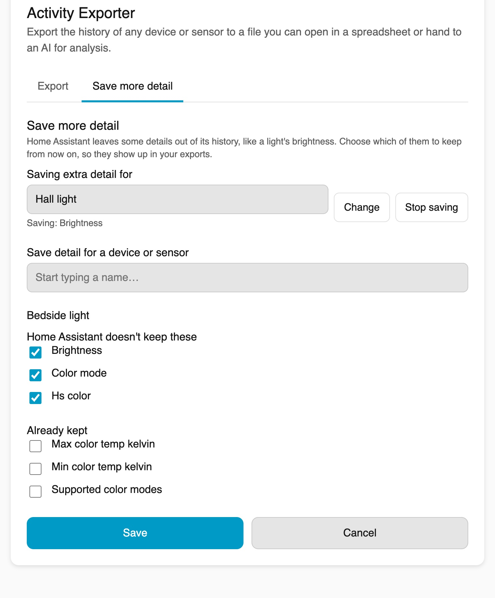

# Activity Exporter for Home Assistant

Export the history of one or more devices or sensors to a **CSV** or **JSON** file,
straight from a panel in your Home Assistant sidebar. No configuration, no scripting.

It gets a faithful copy of your devices' history out of Home Assistant, to open in a
spreadsheet or hand to an AI for analysis. You don't need to know any Home Assistant
jargon: pick your devices, pick a time period, click download.


## What it does

- **Pick a device or sensor** with a searchable selector, or up to 20 to export together in one file.
- **Choose a time period**: last 24 hours, 7 days or 30 days, or your own start and end dates.
- **Every setting in its own column**: temperature, position, mode and more each get a spreadsheet column, and every recorded step is included.
- **Save more detail**: an admin can choose extra details to keep from now on, such as a light's brightness and colour, which Home Assistant normally leaves out. They then show up in exports automatically.
- **Skip repeats**: optionally leave out rows where neither the value nor any setting changed.
- **Download as a spreadsheet (CSV)** for Excel, Numbers or Google Sheets, or **as a data file (JSON)** for an AI.
- **Live progress** while it gathers the history.

It does **not** change, summarise or interpret your data. It exports what Home
Assistant recorded, optionally minus the repeats.

## Installation

### Via HACS (recommended)

1. In Home Assistant, open **HACS → Integrations**.
2. Click the **⋮** menu (top-right) → **Custom repositories**.
3. Add `https://github.com/edwilde/ha-activity-exporter` with category **Integration**.
4. Find **Activity Exporter** in the list and click **Download**.
5. **Restart Home Assistant.**
6. Go to **Settings → Devices & Services → Add Integration**, search for
   **Activity Exporter**, and add it.
7. **Activity Exporter** now appears in your sidebar.

### Manual

1. Copy `custom_components/ha_activity_exporter/` into your Home Assistant
   `config/custom_components/` folder.
2. Restart Home Assistant and add the integration as in steps 5–7 above.

## Using it

1. Open **Activity Exporter** from the sidebar.
2. **What do you want to export?** Start typing the name of a device or sensor and pick it. To export several at once, add another. To take one off the list, clear it with its X, or press Remove if you see a plain text box instead of a dropdown.
3. **Time period**: tap a quick button, or choose your own start and end dates.
4. Optionally turn on **Skip repeats** to leave out rows where nothing changed.
5. Leave **Give each setting its own column** on to get one spreadsheet column per setting (temperature, position, mode and so on; for lights, see [Saving more detail](#saving-more-detail)), or turn it off for a simple three-column file (five columns when several devices are chosen).
6. Click **Download spreadsheet (CSV)** or **Download data file (JSON)**.

## What the files look like

**CSV**: one row each time Home Assistant recorded a change, including a setting changing while the value stays the same. `seconds_since_previous` is the time since the row above. Each setting has its own column; descriptive information such as the name, icon, units and supported modes is left out, and `details` holds anything that could not get a column.

```csv
timestamp,value,seconds_since_previous,current_temperature,hvac_action,temperature,changed_by,details
2026-05-30T06:00:00+12:00,off,,17.5,off,20,,
2026-05-30T06:30:00+12:00,heat,1800,17.6,heating,21,script.morning_warmup (Morning warm-up),
2026-05-30T06:42:30+12:00,heat,750,18.9,heating,21,,
```

With **Give each setting its own column** turned off, the header is `timestamp,value,details` and `details` holds all the extra information as compact JSON.

When Home Assistant knows what caused a change of value, the spreadsheet gains a `changed_by` column before `details`, naming the script, automation, action or person behind it: `script.morning_warmup (Morning warm-up)` above, or `light.turn_on`. A person is shown by name when they have a Home Assistant person with a user account, otherwise by an id such as `user 3f2a...`. The JSON has the same information as a `cause` entry on the row. The column is left out when no row has a cause, or when per-setting columns are turned off.

**JSON**: a self-describing wrapper, so an AI has the context it needs. `entity` describes the device, and each record has a `derived` block of worked-out values, such as whether the value changed and the seconds since the previous row. This is the same three-row export:

```json
{
  "entity_id": "climate.lounge",
  "friendly_name": "Lounge heat pump",
  "entity": {
    "entity_id": "climate.lounge",
    "friendly_name": "Lounge heat pump",
    "domain": "climate",
    "capabilities": {
      "friendly_name": "Lounge heat pump",
      "hvac_modes": [
        "off",
        "heat",
        "cool"
      ]
    }
  },
  "exported_at": "2026-05-30T07:00:00+12:00",
  "period": {
    "start": "2026-05-30T06:00:00+12:00",
    "end": "2026-05-30T07:00:00+12:00"
  },
  "state_changes_only": false,
  "record_count": 3,
  "records": [
    {
      "timestamp": "2026-05-30T06:00:00+12:00",
      "last_changed": null,
      "state": "off",
      "attributes": {
        "friendly_name": "Lounge heat pump",
        "hvac_modes": [
          "off",
          "heat",
          "cool"
        ],
        "hvac_action": "off",
        "current_temperature": 17.5,
        "temperature": 20
      },
      "derived": {
        "state_changed": null,
        "start_of_period": true,
        "seconds_since_previous": null
      }
    },
    {
      "timestamp": "2026-05-30T06:30:00+12:00",
      "last_changed": "2026-05-30T06:30:00+12:00",
      "state": "heat",
      "attributes": {
        "friendly_name": "Lounge heat pump",
        "hvac_modes": [
          "off",
          "heat",
          "cool"
        ],
        "hvac_action": "heating",
        "current_temperature": 17.6,
        "temperature": 21
      },
      "derived": {
        "state_changed": true,
        "seconds_since_previous": 1800
      },
      "cause": {
        "context_entity_id": "script.morning_warmup",
        "context_name": "Morning warm-up"
      }
    },
    {
      "timestamp": "2026-05-30T06:42:30+12:00",
      "last_changed": "2026-05-30T06:30:00+12:00",
      "state": "heat",
      "attributes": {
        "friendly_name": "Lounge heat pump",
        "hvac_modes": [
          "off",
          "heat",
          "cool"
        ],
        "hvac_action": "heating",
        "current_temperature": 18.9,
        "temperature": 21
      },
      "derived": {
        "state_changed": false,
        "seconds_since_previous": 750
      }
    }
  ]
}
```

`last_changed` is when the value itself last changed, so on a row where only a setting changed it is earlier than `timestamp` (above, the heat pump switched on at 06:30:00 and its room temperature reading was updated at 06:42:30).

The first row is usually the value at the start of the period, stamped with the period's start time (06:00:00 above). Home Assistant does not say when that value began, so in JSON the row has `last_changed: null`, `state_changed: null` and `derived.start_of_period: true`. The next row where only a setting changed can show how long it had been in place, as its `last_changed` may reach back before the period. The spreadsheet shows this row with no marker.

`state_changes_only` is `true` when **Skip repeats** was on. `seconds_since_previous` is then measured to the previous row in the file, spanning any rows left out.

## Several devices at once

Choose two or more devices (up to 20) and the download is still one file, with every device's history on one timeline.

**CSV**: rows run in time order across all the devices, with `entity_id` and `name` first. `seconds_since_previous` is measured to the same device's previous row, not the row above. The columns are the combined settings of every chosen device, so a mix of device types gives a wide file with mostly blank cells. In the example the lamp's rows carry only on and off; its brightness (0 to 255) and colour come from a hand-made settings sensor, whose `hs_color` becomes the `hue` and `saturation` columns. Details kept with [Save more detail](#saving-more-detail) appear on the lamp's own rows instead. With per-setting columns turned off, the columns are `entity_id,name,timestamp,value,details`.

```csv
entity_id,name,timestamp,value,seconds_since_previous,color_mode,hue,saturation,current_temperature,hvac_action,temperature,details
light.bedroom_lamp,Bedroom lamp,2026-01-15T13:00:00+13:00,off,,,,,,,,
sensor.bedroom_lamp_settings,Bedroom lamp settings,2026-01-15T13:00:00+13:00,0,,,,,,,,
climate.lounge,Lounge heat pump,2026-01-15T13:00:00+13:00,heat,,,,,20.8,idle,20,
light.bedroom_lamp,Bedroom lamp,2026-01-15T13:10:00+13:00,on,600,,,,,,,
sensor.bedroom_lamp_settings,Bedroom lamp settings,2026-01-15T13:10:00+13:00,128,600,hs,30,80,,,,
sensor.bedroom_lamp_settings,Bedroom lamp settings,2026-01-15T13:10:30+13:00,128,30,hs,30,60,,,,
climate.lounge,Lounge heat pump,2026-01-15T13:15:00+13:00,heat,900,,,,20.2,heating,22,
light.bedroom_lamp,Bedroom lamp,2026-01-15T13:25:00+13:00,off,900,,,,,,,
sensor.bedroom_lamp_settings,Bedroom lamp settings,2026-01-15T13:25:00+13:00,0,870,,,,,,,
```

**JSON**: the shared period and totals come first, then an `entities` list. Each entry has the single-device shape without the period and export time, and its `derived` values come from that device's own rows. The excerpt is trimmed to the second record of the lamp and of its settings sensor, without the heat pump; `entity_count` and `record_count` describe the full file.

```json
{
  "exported_at": "2026-01-15T13:30:00+13:00",
  "period": {
    "start": "2026-01-15T13:00:00+13:00",
    "end": "2026-01-15T13:30:00+13:00"
  },
  "state_changes_only": false,
  "entity_count": 3,
  "record_count": 9,
  "entities": [
    {
      "entity_id": "light.bedroom_lamp",
      "friendly_name": "Bedroom lamp",
      "entity": {
        "entity_id": "light.bedroom_lamp",
        "friendly_name": "Bedroom lamp",
        "domain": "light",
        "capabilities": {
          "friendly_name": "Bedroom lamp",
          "supported_color_modes": [
            "color_temp",
            "hs"
          ]
        }
      },
      "record_count": 3,
      "records": [
        {
          "timestamp": "2026-01-15T13:10:00+13:00",
          "last_changed": "2026-01-15T13:10:00+13:00",
          "state": "on",
          "attributes": {
            "friendly_name": "Bedroom lamp",
            "supported_color_modes": [
              "color_temp",
              "hs"
            ]
          },
          "derived": {
            "state_changed": true,
            "seconds_since_previous": 600
          }
        }
      ]
    },
    {
      "entity_id": "sensor.bedroom_lamp_settings",
      "friendly_name": "Bedroom lamp settings",
      "entity": {
        "entity_id": "sensor.bedroom_lamp_settings",
        "friendly_name": "Bedroom lamp settings",
        "domain": "sensor",
        "capabilities": {
          "friendly_name": "Bedroom lamp settings"
        }
      },
      "record_count": 4,
      "records": [
        {
          "timestamp": "2026-01-15T13:10:00+13:00",
          "last_changed": "2026-01-15T13:10:00+13:00",
          "state": "128",
          "attributes": {
            "friendly_name": "Bedroom lamp settings",
            "color_mode": "hs",
            "hs_color": [
              30,
              80
            ]
          },
          "derived": {
            "state_changed": true,
            "seconds_since_previous": 600
          }
        }
      ]
    }
  ]
}
```

The file is named `activity-export_<number>-items_<start>_<end>.csv` (or `.json`), for example `activity-export_3-items_2026-01-15_2026-01-15.csv`.

## How it works (for the curious)

The panel runs in your browser with your existing Home Assistant login. It reads
history over the WebSocket API (`history/history_during_period`), asks the logbook
(`logbook/get_events`) what caused each change, and builds and downloads the file in
the browser. Nothing is sent anywhere else and no history endpoint is added. The only
server-side parts are the hidden sensors behind [Saving more detail](#saving-more-detail)
and three commands the panel uses to list, look up and choose what they keep. History
is fetched a day at a time, for all the chosen devices at once, which drives the
progress bar.

## Saving more detail

Home Assistant leaves some details out of its history on purpose. A light's brightness and colour, a speaker's inputs and sound modes, a heat pump's supported fan modes and many more are shown live but never saved ([home-assistant/core#121776](https://github.com/home-assistant/core/pull/121776) made this change for lights). An export shows a row for each step such a device took, but without those details, and **Skip repeats** can drop those rows because nothing recorded changed.

The **Save more detail** tab keeps them, with no configuration files:

1. Open **Activity Exporter** and switch to the **Save more detail** tab.
2. Pick a device or sensor.
3. Tick the details to keep. The ones Home Assistant doesn't normally save are ticked for you.
4. Click **Save**.



From then on the details are saved, and exports of that device include them on its own rows. Use **Change** to alter what is kept, or **Stop saving** to stop.

Good to know:

- Only Home Assistant admins see the tab. Anyone who can export gets the saved details.
- Saving starts from now. Earlier history can't be filled in.
- Access tokens, passwords, picture links and similar are never offered.
- Details that change very often, such as a playing song's position, use more space, so they start unticked and are marked.
- Each saved device adds one hidden sensor holding its details. Stopping removes the sensor; what it saved stays in your history until Home Assistant's normal clean-up.
- If the details are too big for Home Assistant to store, the biggest are left out and the tab lists them.
- If a saved device is renamed or removed, the tab shows "Can't find this any more". Stop saving it and add it again under its new name.

## Limitations

- Only history Home Assistant recorded can be exported, plus any detail you chose to save from the moment you saved it. A device excluded from recording, or a range older than your retention period, gives nothing.
- The file is built in your browser, so very long ranges of a busy sensor may be slow.
- `changed_by` is blank for steps that only change a setting (a room temperature reading, for example), because Home Assistant only notes what caused a change of value. It is also blank for sensors with a unit, which Home Assistant leaves out of its activity log.

## Development & testing

```bash
# Frontend pure-function tests (no build step required)
node --test tests/frontend/*.test.mjs

# Python tests
pip install -r requirements_test.txt
# The test helper doesn't pull in the frontend asset package; install the
# version Home Assistant core pins:
pip install -c "$(python -c 'import os,homeassistant;print(os.path.join(os.path.dirname(homeassistant.__file__),"package_constraints.txt"))')" home-assistant-frontend
pytest
```

CI runs Home Assistant's `hassfest`, HACS validation, and both test suites on every push.

## License

[MIT](LICENSE)
